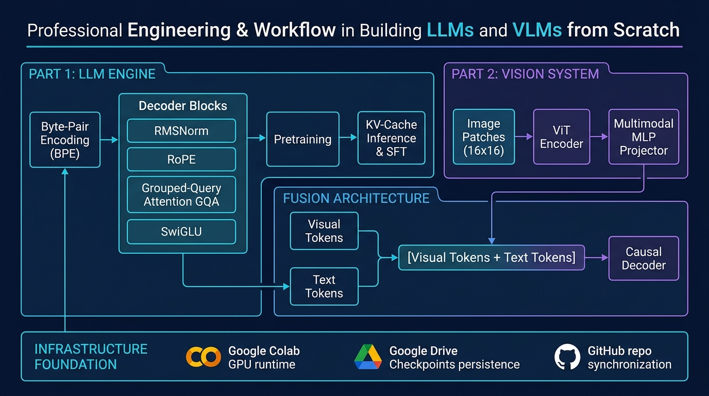

# LLMs and VLMs From Scratch

[](https://colab.research.google.com/github/Uchihakamal1816/llms-and-vlms-from-scratch)
[](https://opensource.org/licenses/MIT)
[](https://www.python.org/downloads/)
[](https://pytorch.org/)

An end-to-end, deep-dive implementation journey of **Large Language Models (LLMs)** and **Vision-Language Models (VLMs)** from foundational mathematical principles to running models, implemented completely from scratch.

> [!NOTE]
> All architectural layers, tokenizers, attention mechanisms, projectors, training loops, and inference engines in this repository are coded by hand without high-level wrapper libraries (e.g., using pure PyTorch tensors, modules, and matrix operations).

---

## 🏛️ System Architecture & Workflow

<p align="center">
  
</p>

---

## 🗺️ Curriculum & Roadmap

### 🧠 Part 1: Large Language Models (`llm/`)
Target Architecture: Modern Decoder-Only Transformer (Llama/Mistral style: RMSNorm, RoPE, SwiGLU, GQA)

| Phase | Milestone | Focus Areas | Guide / Spec | Notebook |
| :--- | :--- | :--- | :--- | :--- |
| **01** | **Tokenization** | Byte Pair Encoding (BPE), vocabulary build, merge rules, encode/decode | [`01_tokenization/README.md`](llm/01_tokenization/README.md) | [`01_bpe_tokenizer.ipynb`](llm/notebooks/01_bpe_tokenizer.ipynb) |
| **02** | **Architecture** | Embedding, RoPE, RMSNorm, Multi-Head / Grouped Query Attention, SwiGLU MLP, Residual Stack | [`02_architecture/README.md`](llm/02_architecture/README.md) | [`02_transformer_decoder.ipynb`](llm/notebooks/02_transformer_decoder.ipynb) |
| **03** | **Pretraining** | Causal LM loss, data packing, AdamW, cosine schedule, warmup, mixed precision, gradient accumulation | [`03_pretraining/README.md`](llm/03_pretraining/README.md) | [`03_pretraining.ipynb`](llm/notebooks/03_pretraining.ipynb) |
| **04** | **Inference & KV Cache** | Autoregressive generation, KV caching, Greedy, Temperature, Top-$k$, Top-$p$ (Nucleus), Repetition penalty | [`04_inference/README.md`](llm/04_inference/README.md) | [`04_inference_kv_cache.ipynb`](llm/notebooks/04_inference_kv_cache.ipynb) |
| **05** | **Instruction Fine-Tuning** | Supervised fine-tuning (SFT), chat templates, loss masking on prompt, LoRA from scratch | [`05_finetuning/README.md`](llm/05_finetuning/README.md) | [`05_sft_finetuning.ipynb`](llm/notebooks/05_sft_finetuning.ipynb) |

---

### 👁️ Part 2: Vision-Language Models (`vlm/`)
Target Architecture: LLaVA-style Autoregressive Multimodal Model (Vision Transformer + Multimodal Projector + Causal LLM Backbone)

| Phase | Milestone | Focus Areas | Guide / Spec | Notebook |
| :--- | :--- | :--- | :--- | :--- |
| **01** | **Vision Encoder** | Patch projection $(P \times P)$, 1D patch sequence, 2D positional embeddings, Multi-Head Self-Attention, ViT backbone | [`01_vision_encoder/README.md`](vlm/01_vision_encoder/README.md) | [`01_vision_transformer.ipynb`](vlm/notebooks/01_vision_transformer.ipynb) |
| **02** | **Multimodal Projector** | Dimension alignment $(D_{vision} \to D_{language})$, Linear & 2-Layer MLP projector with GELU, spatial pooling | [`02_projector/README.md`](vlm/02_projector/README.md) | [`02_multimodal_projector.ipynb`](vlm/notebooks/02_multimodal_projector.ipynb) |
| **03** | **Multimodal Architecture** | Interleaving visual tokens and text tokens, unified sequence construction, causal attention masks | [`03_multimodal_architecture/README.md`](vlm/03_multimodal_architecture/README.md) | [`03_vlm_architecture.ipynb`](vlm/notebooks/03_vlm_architecture.ipynb) |
| **04** | **2-Stage Training** | Stage 1: Feature alignment (freeze vision & LLM, train projector on image-caption pairs). Stage 2: Visual instruction tuning | [`04_training/README.md`](vlm/04_training/README.md) | [`04_vlm_pretraining.ipynb`](vlm/notebooks/04_vlm_pretraining.ipynb) |
| **05** | **Multimodal Inference** | Multimodal prompt processing, image preprocessing pipeline, autoregressive visual question answering | [`05_inference/README.md`](vlm/05_inference/README.md) | [`05_vlm_inference.ipynb`](vlm/notebooks/05_vlm_inference.ipynb) |

---

## 📁 Repository Layout

```text
.
├── COLAB_WORKFLOW.md               # Guide for running, training, and syncing on Google Colab
├── requirements.txt                # Core dependencies (PyTorch, einops, datasets, etc.)
├── README.md                       # Project master index and roadmap
├── llm/                            # Part 1: Large Language Models
│   ├── README.md                   # LLM Master Architecture Guide & Math Spec
│   ├── 01_tokenization/            # Specs & exercise details for BPE Tokenizer
│   ├── 02_architecture/            # Specs & tensor shapes for Transformer Decoder
│   ├── 03_pretraining/             # Pretraining loop, loss, data pipeline specifications
│   ├── 04_inference/               # KV-cache generation engine specifications
│   ├── 05_finetuning/              # SFT & LoRA specifications
│   └── notebooks/                  # Colab-ready implementation notebooks
└── vlm/                            # Part 2: Vision-Language Models
    ├── README.md                   # VLM Master Architecture Guide & Math Spec
    ├── 01_vision_encoder/          # ViT specifications & patch embedding mechanics
    ├── 02_projector/               # Multimodal projector specifications
    ├── 03_multimodal_architecture/ # Visual-Text fusion & attention mechanics
    ├── 04_training/                # 2-Stage training recipe specifications
    ├── 05_inference/               # Multimodal generation & inference engine
    └── notebooks/                  # Colab-ready implementation notebooks
```

---

## ⚡ Colab Quickstart

To run and train on Google Colab with free T4 GPUs:

1. Follow the step-by-step instructions in [`COLAB_WORKFLOW.md`](COLAB_WORKFLOW.md).
2. Open any notebook from `llm/notebooks/` or `vlm/notebooks/` directly in Colab:
   - Click the "Open in Colab" badge or enter:
     `https://colab.research.google.com/github/Uchihakamal1816/llms-and-vlms-from-scratch/blob/main/<path-to-notebook>.ipynb`
3. Mount Google Drive to persist checkpoints across sessions.
